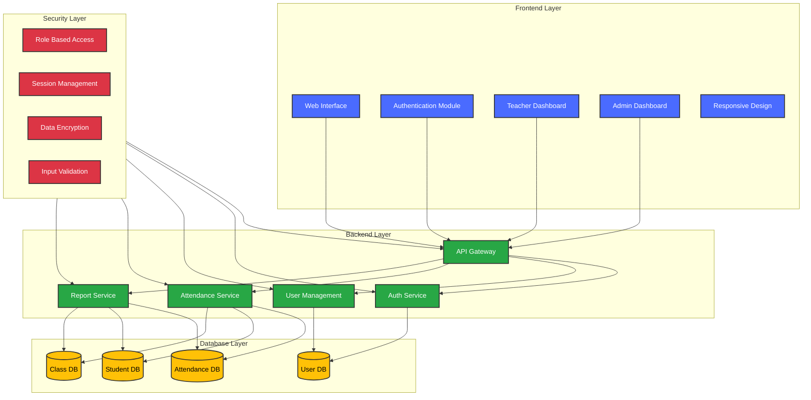
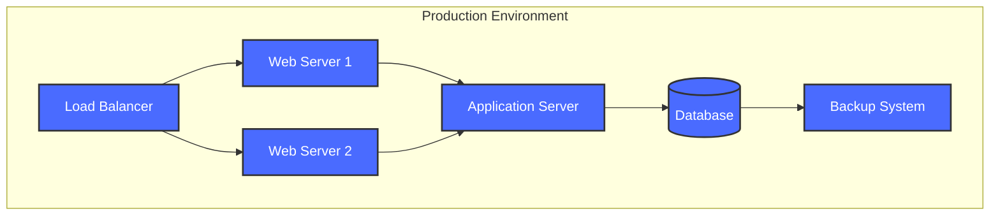

# Attendance Management System Architecture

## System Architecture Diagram

## Component Descriptions

### Frontend Layer
- **Web Interface**: Main user interface built with HTML, CSS, and JavaScript
- **Authentication Module**: Handles user login and session management
- **Teacher Dashboard**: Interface for teachers to mark attendance
- **Admin Dashboard**: Interface for administrators to manage the system
- **Responsive Design**: Ensures the system works on all devices

### Backend Layer
- **API Gateway**: Entry point for all frontend requests
- **Auth Service**: Handles user authentication and authorization
- **User Management**: Manages user accounts and roles
- **Attendance Service**: Core service for attendance operations
- **Report Service**: Generates attendance reports and analytics

### Database Layer
- **User DB**: Stores user information and credentials
- **Attendance DB**: Stores attendance records
- **Student DB**: Stores student information
- **Class DB**: Stores class and course information

### Security Layer
- **Role Based Access**: Controls user permissions
- **Session Management**: Manages user sessions
- **Data Encryption**: Secures sensitive data
- **Input Validation**: Prevents malicious input

## Data Flow

1. User Authentication Flow:
   - User enters credentials
   - Frontend sends to Auth Service
   - Auth Service validates and creates session
   - User is redirected to appropriate dashboard

2. Attendance Marking Flow:
   - Teacher selects class
   - System loads student list
   - Teacher marks attendance
   - Data is saved to Attendance DB

3. Report Generation Flow:
   - Admin requests report
   - Report Service queries databases
   - Data is processed and formatted
   - Report is generated and displayed

## Security Measures

1. Authentication:
   - Secure password storage
   - Session management
   - Token-based authentication

2. Authorization:
   - Role-based access control
   - Permission validation
   - Secure API endpoints

3. Data Protection:
   - Data encryption at rest
   - Secure data transmission
   - Input validation and sanitization

## Deployment Architecture

## Scalability Considerations

1. Horizontal Scaling:
   - Multiple web servers
   - Load balancing
   - Database replication

2. Performance Optimization:
   - Caching layer
   - Database indexing
   - Query optimization

3. High Availability:
   - Redundant servers
   - Failover systems
   - Backup and recovery 