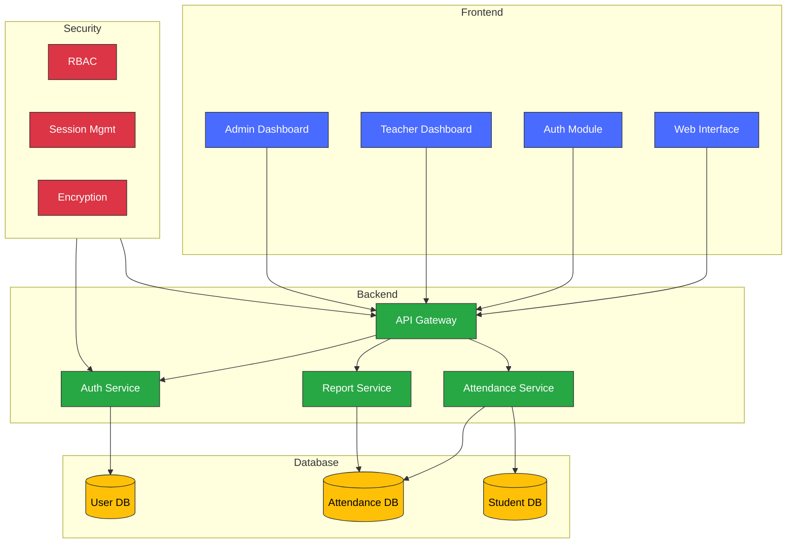

# Attendance Management System - Architecture

## Key Components

### Frontend
- Web Interface (HTML/CSS/JS)
- Authentication Module
- Teacher/Admin Dashboards

### Backend
- API Gateway
- Auth Service
- Attendance Service
- Report Service

### Database
- User DB
- Attendance DB
- Student DB

### Security
- Role-Based Access Control
- Session Management
- Data Encryption

## Data Flow
1. User Auth → API → Auth Service → User DB
2. Attendance → API → Attendance Service → Attendance DB
3. Reports → API → Report Service → Multiple DBs

## Deployment
- Load Balancer
- Web Servers (2x)
- Application Server
- Database Server
- Backup System 